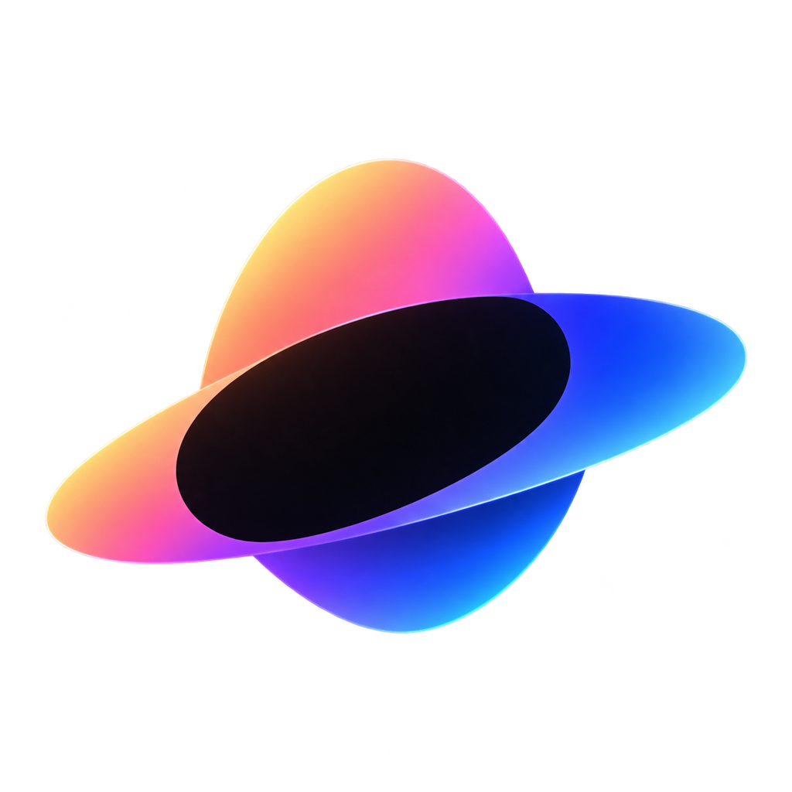

  

<h1 align="center">Solar</h1>

CREATE WORLDS WITH AI

Solar's assistant can optionally choose compatible partner assets, import only the
needed files, and instantiate Godot presets. Browse **Files → Asset library** or
describe the feature in chat. See [asset library integration](docs/asset-library.md).

  
  

**Solar** is an AI-powered game engine that lets you build video games with AI. Games are real [Godot 4](https://godotengine.org) projects under the hood, and
the AI assistant is powered by the [OpenCode](https://opencode.ai) CLI. Everything — the engine,
git, and the AI agent — ships inside the app, so there's nothing to install or configure beyond
an API key.

*Earlier app screenshot. [Play the demo](https://legojazz.itch.io/survival-fortress).*

## Game development guidance

The assistant uses the bundled Godot Game Dev Studio library (189 skills) and
six Solar modules through OpenCode's native `skill` tool. Full instructions load
when a skill is selected; `game_guidance` helps find skills and read supporting
examples. The library is pinned, available offline, and adapted through Solar's ECS rules.
See [guidance usage and limits](docs/game-guidance.md) and
[upstream attribution/licenses](resources/game-guidance/README.md).

## Production workflow preview (Windows)

An optional Microsoft Agent Framework sidecar coordinates BMAD planning,
task-scoped native skills, controlled OpenCode roles, Godot AI execution,
GdUnit4 tests and an evidence-based TEA gate. It is disabled by default while
complete model-driven acceptance is pending. See [setup, ownership, recovery,
locks and acceptance status](docs/production-workflow.md).

## Free and Open Source

Solar is free and open source under the GPLv3-or-later license. Games you create are yours.
Godot is a key open-source technology that makes Solar possible.

## Build installers

With Node.js 22 and npm installed, run `npm ci` to install dependencies and stage the bundled
Godot and OpenCode binaries. Run `npm run dev` for development or `npm run dist` to package the
current platform. The **Release builds** GitHub Actions workflow packages Windows, Linux, Apple
Silicon macOS, and Intel macOS installers when a `v*` tag is pushed; it can also be started
manually. Workflow artifacts are kept for 30 days and are not published as GitHub Releases.

Windows builds of the production preview also need its locked offline bundles:
run `npm run build:orchestrator` with .NET SDK 10.0.401 and
`npm run production:execution` with uv. See the [maintainer instructions](docs/production-workflow.md).
These tools are build prerequisites; packaged app users do not need to install them.

## Why Solar (vs. a coding agent like Claude Code)

Claude Code and OpenCode are excellent general-purpose coding agents — but they assume you already
have a dev environment, are comfortable in a terminal, can easily create art assets, and can wire
up a game engine and an export process yourself. Solar uses that same class of AI agent, but
packages it for one job: making a game.

- **The AI tests its own work** — through a built-in MCP harness, the assistant can run the game
  off-screen, send scripted input, take screenshots, and query game state — so it catches broken
  changes before telling you it's done, instead of you finding out later. You spend less time
  debugging, and more time in the creative process.

- **Art, not just code** — 2D and 3D asset generation is built into the same chat, so sprites,
  icons, and models land straight in your project alongside the code that uses them. Note: I plan
  to add audio (music and sound effects) generation in the future as well.

- **One-click export** — ship to all six Godot platforms without touching an export pipeline
  yourself (MacOS, Linux, Windows, iOS, Android, Web).

Claude Code is the right tool if you're a developer who wants an agent inside your existing
workflow. Solar is for anyone who wants to make a game, with the same caliber of AI doing the
work end-to-end.

## Getting started

### 1. Install and create a project

Build and open Solar. From the welcome screen, click **Create a game**.

### 2. Connect your AI assistant

Open **Connect your AI assistant** through the gear icon to configure AI generation.
Creating projects, opening the Godot editor and Run work without an API key. Settings has three tabs:

**Models** — required for AI generation; each slot chooses an API provider, base URL, model ID, and API key. The
native providers are **OpenAI**, **Anthropic**, **Google Gemini**, **xAI**, and **NVIDIA**. **OpenRouter** is the
default, and **Custom (OpenAI-compatible)** supports compatible gateways. NVIDIA uses NVIDIA API keys and NVIDIA NIM
model IDs. The single **Chat model** and separate **Image model**
can use different providers. Use **Check & load** to verify the connection and fetch that
provider's model catalog as type-ahead suggestions; the model field still accepts a custom ID. The
Image slot reports whether the provider confirms image input for the selected model. Leave a slot's
key blank to copy a key from another slot when both use the same provider and base URL. For
OpenRouter, get a key from [openrouter.ai/keys](https://openrouter.ai/keys). For NVIDIA, create
an API key in [NVIDIA Build](https://build.nvidia.com/) and choose **NVIDIA** in the provider list.
| Slot | Role |
| --- | --- |
| **Chat model** | Plans and prepares game changes; also executes the assigned planning and TEA roles in Microsoft mode |
| **Image model** | Reads reference images and original gameplay screenshots; must accept image input |

Reasoning controls use the selected model's supported effort/budget contract.
The prompt composer exposes its available effort levels; a model without confirmed
reasoning support does not receive invented levels. Medium/Large identifiers remain
readable internally for migration of older saved settings.

**Asset generation** *(optional)* — two more tabs let the assistant create art straight into your
project's assets folder:

| Tab | What it enables | Credentials |
| --- | --- | --- |
| **2D Asset Generation** | Sprites, icons, and UI as transparent 1024×1024 PNGs, via OpenAI's gpt-image-1.5 | OpenAI API key from [platform.openai.com/api-keys](https://platform.openai.com/api-keys) |
| **3D Asset Generation** | 3D models, via Tencent's Hunyuan 3D | **Tencent SecretId** and **SecretKey** from the Tencent Cloud console, under Access Management (CAM) → API Keys — see [Tencent's Hunyuan-to-3D docs](https://www.tencentcloud.com/document/product/1284/75287) |

Skipping a tab just disables that capability; the assistant will explain what it can't do rather
than failing silently.

**Credential storage** — API keys entered in Solar Settings are encrypted with the operating
system's secure storage and passed to Solar's OpenCode process at runtime. On Linux, saving
keys requires GNOME Keyring or KWallet; Solar won't fall back to an insecure plaintext store.
Keys already saved by OpenCode in its shared `auth.json` stay there until you choose **Move legacy
OpenCode credentials** in Settings. Select only the provider keys you want to move: Solar
encrypts those keys in its own vault, removes just those entries from the shared file, and keeps an
encrypted backup. Settings can restore that file while it still matches the version created by the
migration.

### 3. Build your game

Describe what you want in the chat — the assistant writes the code, and you can hit **Run** any
time to play the current build right in the window. Ask it for art (2D or 3D) too ("give the player a
pixel-art sprite").

### 4. Shipping your game

When you're ready to ship, click **Export** and pick any combination of Godot's six platforms —
Godot's export templates download automatically the first time you export: **Windows**, **macOS**, 
**Linux**, **Web**, **Android**, and **iOS**.
