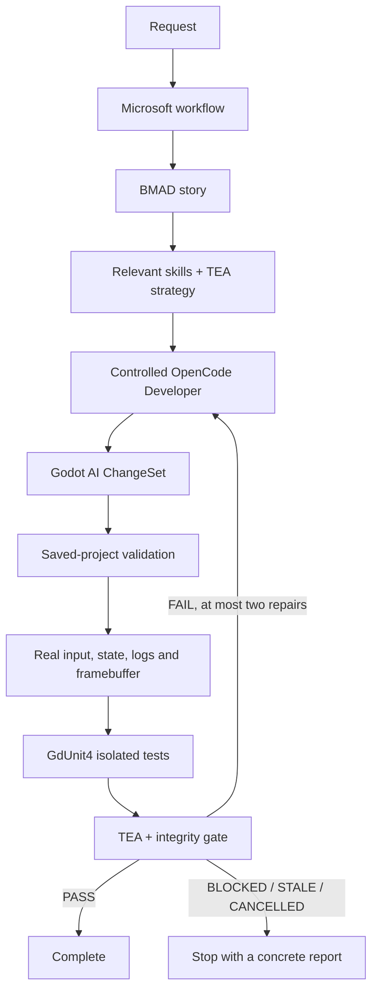

# Solar AI production workflow

## Delivery status

### Game Studio experience (September 30 update)

The assistant contains an optional **Game Studio** section. Enable it for new
messages, prepare the project with the editor closed, open the embedded editor
and use **Check connections**. Initial rendering is read-only and makes no
provider call. The explicit connection check inspects credentials/catalog
capabilities and the authenticated editor; it does not generate model output or
guarantee provider availability during a later story. Unsaved scenes/scripts,
imports, incompatible addons and missing image review are explained in place.
The regular editor remains accessible without credentials.

During a story the section shows the current stage, elapsed time and observed
assistant tool activity. Echoed user prompts never count as model response.
Stop, concrete critical approval, checkpoint resume and setup recovery are
available. Failures appear before preparation details. Project identity and
event order protect against late updates; a running turn cannot change modes.
Accepted criteria show descriptions and original evidence types. Only a real
PASS adds a verified-feature summary to chat; interrupted sends restore drafts.

Every workflow model role uses OpenCode's native `json_schema`/StructuredOutput
tool and bounded host validation. The selected model and reasoning are retained.
OpenCode 1.17.13's bulk message encoder rejects a persisted structured user
format, so Solar retrieves actual assistant tool messages by IDs from its
authenticated stream. Original TEA evidence reads are still verified. Solar
supplies each complete assigned skill before the model turn, checking exact
bytes, SHA-256, manifest, name and cache links. Per-stage delivery allows at most
eight documents, 64 KiB each and 192 KiB total; excess fails explicitly rather than
truncating rules. Integrity is checked again before accepting the stage.
`skillContext` receipts record this host delivery separately from `loadedSkills`,
which records only completed native tool calls in actual assistant messages.
An optional native call is therefore never invented to accept StructuredOutput.
Planner facts are revision-bound and limited to relevant product sources, with no
addon/library discovery; native per-session permissions and the Solar policy
constrain it to its skill, methodology and final artifact tools.

The reference broker resolves a private Microsoft session lease supplied by the
OpenCode hook. Scoped searches rank only assigned guides. Guide reads cannot
borrow another guide's source directory; methodology search/read is limited to
the role's BMAD or TEA namespace. Native registry names must resolve uniquely to
the exact expected snapshot file. Cancelled or failed registrations remove their
lease, and oversized methodology lines fail rather than returning endless empty
pages. Existing pinned upstream documents and personal configs remain unchanged.

The full selected NVIDIA story remains unaccepted: one trial exceeded the output
limit, and the subsequent scoped-planner trial exhausted three Microsoft-owned
transient attempts. No product write occurred. The smaller native BMAD role
acceptance passed. Local 2D/3D workflows with genuine Godot/asset/test evidence
passed using model fixtures; these do not replace live model quality acceptance.
The preview therefore remains disabled by default.

The Windows preview contains the Microsoft workflow foundation and controlled
OpenCode executor, plus incremental planning, editor, test, evidence and UI
adapters. It is **disabled by default**. This is not yet a production acceptance
of the complete model-driven chain.

On this machine the real Microsoft SDK checkpoint/resume, approval, retry,
repair, parallel read and Stop checks passed. Both embedded editor backends
applied 2D and 3D fixtures, sent real input, observed changed node state,
captured original game framebuffers and returned clean runtime logs. The actual
production validation and GdUnit4 adapters also passed on those same addon-installed
2D/3D projects, including discovery and original evidence integrity. A deliberately
broken suite failed. One real request on
the selected NVIDIA model loaded the native BMAD skill and returned valid JSON.
The selected model also called the native library tool and returned an exact
installed source hash/preset. Full live planning remains BLOCKED: earlier runs
timed out or exhausted the generic 12-step cap; after fixing role limits and
scoping the skill indexes, the 3D asset story encountered a provider retry and
then a response cut off at `finish: length` (8,192 output tokens). No product
write began. A local endpoint using the actual bundled OpenCode/AI SDK verified
that the selected NVIDIA `reasoning_budget=4096` and role `max_tokens=8192`
reach the real HTTP body. This verifies transport, not model answer quality.

An explicitly authorized temporary OpenRouter/Kimi workflow was previously
rejected by the provider's credit limit. The selected image model subsequently
accepted an original Godot framebuffer and returned structured inspection after
the ordinary vision budget was bounded to 1,024 tokens. This is a capability
check, not feature acceptance. The protected global provider config and original
model/credential settings were verified unchanged. No full live feature PASS is
claimed; a redundant 2D live retry was avoided after the planner blocker.

The explicit offline adapter acceptance now traverses the complete real Microsoft
graph and OpenCode executor, loads the selected native skills, applies changes in
LibGodot, checks original framebuffer pixels and real before/after input state,
runs GdUnit4 and completes a constrained fixture gate for both 2D and 3D. Its local
model endpoint is deterministic: these PASS results certify the adapters, not a
live AI model's judgment. An intentional failing assertion remains FAIL after
exactly two Microsoft repair rounds. A synthetic transient vision-provider error
is retried against the same capture with only one runtime launch. Native TEA reads
of all original structured artifacts are also verified.

The partner-asset variant also passed through the real native library tool and
hash-locked ChangeSet import. The 2D case moves a measured 64x64 Mana Seed pose,
collects a pickup and exposes its counter; the runtime and GdUnit4 both verify
the actual 8x8 sprite grid. Manual original-framebuffer inspection caught a
whole-sheet selection in the earlier fixture; the corrected 2D fixture was
rerun alone and now displays one character. Animation semantics remain
unverified. The 3D case moves a CharacterBody3D into an installed Nature model
and verifies that its generated static collider stops movement. Each fixture
executes two meaningful cases with no failures or skips. Exact imported bytes,
original screenshots, input/state, source hashes and preset recipes are checked.
These are local model fixtures, not complete live AI feature acceptance.

Windows unpacked/ZIP packaging was updated with the preflight, role-budget and
compact methodology adapters. The isolated packaged Solar process
opened its sandboxed renderer/preload, API-free LibGodot editor and embedded Run,
and verified/prepared its offline .NET/Python/skill/addon bundles. Run reached the
embedded running state without texture/font parse/load failures. A previous
overlapping smoke attempt observed a stopped runtime; isolated repeats passed.
One later smoke timed out on shutdown. LibGodot now waits for the actual worker
thread exit, rather than resolving on its earlier native-ended message; the host
window stays alive through FFI teardown. Package acceptance also checks this
shutdown ordering and a clean exit code.
The early geometry-message diagnostic was fixed in the native backend and both
asset gateway backend fixtures passed. Interactive drag/cursor acceptance remains
separate. NSIS generation was blocked by this machine's Windows Application
Control when electron-builder tried to execute its temporary uninstaller builder.
No completed/smoke-tested NSIS installer is claimed; that incomplete stub was
removed. A ZIP is available without changing the machine's execution policy.

Remaining release acceptance includes complete live-model 2D/3D stories with
TEA PASS, installer smoke acceptance and interactive drag/cursor regressions. These are the conditions
for enabling the preview by default. The existing backend/drag/cursor code is
preserved; its full interactive regression has not been performed in this work.

## Ownership

| Component | Owns | Does not own |
| --- | --- | --- |
| Microsoft Agent Framework | Workflow graph, role dispatch, two parallel reads, one writer, bounded retries/repairs, SDK checkpoints and critical approval | Provider credentials or editor lifecycle |
| BMAD planning adapter | Scoped story, criteria, English retrieval keywords; GDD/epics/milestones for a new game | Product implementation, upstream installers or agent routing |
| Existing bgrenat library | Task-specific Godot/game development knowledge | A second master, `studio-*` handoffs or bulk context loading |
| OpenCode | A separate read-only model session for each assigned role | Native `task`, shell/write tools, autonomous retry or context rollover |
| Godot AI | Verified scene/script/resource execution, runtime input/state/logs/framebuffer | Decisions, its `test_run`, independent vision/model requests |
| GdUnit4 | Discovery and tests in an isolated saved-project snapshot | Live cache changes or quality acceptance |
| BMAD TEA | Test/evidence strategy, read-only criterion evaluation | Code changes or test execution |
| Solar | Transport, lifecycle, contracts, artifact storage, mechanical integrity constraints and UI | Silently falling back to another orchestrator during a run |



## Source and dependency locks

| Source | Version | Commit / lock |
| --- | --- | --- |
| Microsoft Agent Framework Workflows | 1.22.0 | `0c9944cc9f577d51277ac7c55dbc388b60a577af`; NuGet `packages.lock.json` |
| BMAD Game Dev Studio | 0.7.2 | `2486f5f5f3b8870baa6cee4615a870c0330f441c` |
| Existing bgrenat library | Existing pin | `9e2b2beaf0bc7ba2e27a40326d058ff2c7a619a9` |
| Godot AI | 4.2.3 | `f58314d9473d11efef94dd68b523e1b52643d736` |
| GdUnit4 | 6.2.1 | `08ffc7c65b61b1b2edd545616061a99973c13ce1` |
| BMAD TEA | 1.27.2 | `d99ad29c62697c152e3393351406686d5bcd323c` |
| Bundled execution Python | 3.12.14 | Hash inventory plus 73 pinned, hash-locked wheels |
| Maintainer .NET SDK | 10.0.401 | `orchestrator/global.json`; `net10.0`, self-contained `win-x64` |

The existing 189 guides and six Solar modules were not re-vendored. All 3,066
catalog files matched their original byte sizes and SHA-256 hashes. The new
BMAD/TEA content has separate `solar-bmad-*` / `solar-tea-*` native skills and a
separate immutable native cache. The source manifest records original URLs,
commits, sizes and hashes. MIT licenses accompany the new upstream content;
the existing library retains its LGPL/GPL notices.

The Godot AI release bundle's signed manifest is verified with the pinned RSA
public key before vendoring. Its Python sources are compared to the exact
tagged commit. Bundled runtime files are checked before use. No upstream
installation hook, `_bmad` customization, or personal MCP configurator runs.
Normal app startup does not resolve or download Python/.NET dependencies.

## Start the preview

1. Open a project. API-free editor access and the normal Run button remain
   available in the default mode.
2. Open **Production workflow** in Chat and enable **Microsoft workflow**.
3. Save and close the 2D / 3D editor, then choose **Prepare project**. This
   installs the two explicitly described addons and enables Godot AI. Different
   existing user addons are a blocker and are preserved.
4. Open the project's 2D / 3D editor and send a small scoped feature or bug story.
5. Review a critical operation's file/operation scope before approving. Watch
   Planning, Developing, Applying, Runtime verification, Tests and Quality review.

Project preparation stages complete directories before exposing them to the
editor. A settings conflict leaves the current settings intact. If another
installation appears during preparation, it is preserved. Complete new addon
directories may remain after a late conflict; repeating preparation preflights
them rather than overwriting them.

The app-owned overlay is applied only to the project copy of Godot AI. It
requires adoption of Solar's bundled authenticated backend, exposes unsaved
scene/script state and filesystem import readiness, and disables independent
vision routing. The upstream offline bundle is unchanged. Connections require
the exact canonical project path, embedded editor PID and plugin version.
Unsupported connections report unavailable and do not launch another editor.

## Contracts, recovery and acceptance

- The versioned contracts live in `src/shared/production.ts`. Task, stage,
  evidence, approval and gate records retain run/story/revision identity;
  stage and evidence records reference the monotonic workflow event sequence.
- `orchestrator/` uses the real Microsoft SDK `WorkflowBuilder`, typed approval
  `RequestPort`, `FileSystemJsonCheckpointStore` and JSON checkpoint manager.
  Local metrics are not substituted for checkpoints.
- Saved checkpoints and run records are under the existing Solar profile's
  `production/runs/<runId>/`. Originals and their hashes are in `evidence/`.
- Each role has a separate OpenCode session and an explicit lease. The native
  `task`, shell and mutation tools are denied by both agent permissions and the
  app-owned tool hook. Selected and actually loaded native skills are recorded.
  At most three relevant upstream technical skills are selected for development,
  plus the needed Solar modules. `studio-*` is excluded from technical dispatch.
  Task-derived dimension/style and skill allowlists, Developer-only asset
  selection, and exact source/hash/preset receipts constrain every attempt. See
  [task-bound AI selection](ai-selection-guards.md) for the enforced boundaries.
- Solar supplies role session titles, preventing OpenCode from making extra
  title-generation requests. Role output limits reserve room for explicit
  reasoning token budgets and preserve the selected reasoning options. Unknown,
  truncated, reasoning-only or missing final artifacts are blockers. Numeric
  attempt diagnostics are persisted in `attempts/`; prompts, tool input/output
  text and credentials are not stored in these diagnostics.
- Before a feature proceeds to development, configured credentials, the selected
  chat/image catalog entries and explicit image-input capability are checked.
  Missing or unverified capability blocks the run. OpenRouter's official key
  quota is inspected where available: unknown/unlimited key caps are not treated
  as proof of account balance. Catalog/quota requests are read-only, bounded and
  cancellable by Stop. Questions can still be answered without a vision model.
- Native role steps are bounded separately: Planner 20, Developer 24, TEA
  Strategy 16, TEA Gate 24 and Vision Reviewer 4. The complete multi-round role
  request has a 20-minute ceiling (Developer 30, Vision 5), with immediate Stop
  cancellation. A native step-limit summary is BLOCKED, never parsed as a
  successful artifact. Small stories target at most six inspection rounds;
  independent reads and assigned skill loads are grouped when supported.
- The three app-owned BMAD/TEA skill indexes contain only three or four relevant
  starting points. Full upstream snapshots and their pins remain unchanged;
  optional targeted retrieval is available. A small story does not traverse the
  upstream GDD workflow or inspect addon internals. Vision output is capped at
  1,024 tokens unless the chosen explicit reasoning budget needs more room.
- Microsoft owns up to twelve total attempts for transient read/model failures,
  scheduling retries within a five-minute recovery window after the first failure,
  and at most two repairs after the initial implementation. OpenCode retry events
  abort the local session and return control to Microsoft. Quota exhaustion is a
  blocker. Automatic compaction is disabled in the per-process managed config.
  Reconnecting status includes attempt/countdown; Stop cancels the wait. Silent
  model calls are reconciled after three minutes without observed progress.
- Writes are serialized. A persisted intent precedes each gateway mutation.
  An interrupted, unacknowledged write is blocked and is not automatically
  repeated. A complete operation is replayed by reference on resume.
- Initial contracts wait for a stable imported project. Prepared ChangeSets are
  never silently rebased. Each command checks current hashes, session identity
  and unsaved editor state. User scene/script edits are not saved or overwritten.
- Resume checks the entire saved project revision. A changed revision produces
  STALE and requires a new story; old tests/screenshots/approvals are not reused.
  Stop aborts pending generation, executor calls and test processes. Runtime
  cleanup is verified; an unconfirmed stop remains a blocker.
- Original runtime/input/framebuffer links are persisted before vision review.
  Microsoft can retry a transient vision model request up to its normal bound
  using that same hash-checked capture. Actual game/input effects are not replayed.
  Changed revisions, unsaved user work, a user runtime or tampering block reuse.
  Vision receives the current logs, actual measured input/node responses and
  original image without duplicated scene trees. Complete original trees remain
  in the durable evidence files for the gate.
- Resume uses a real SDK checkpoint and refuses unacknowledged writes. Initial
  planning with no accepted stages or mutations may restart the original saved
  request before the first checkpoint exists. Unexpected orchestrator disconnects
  trigger up to three safe process recoveries; model retry policy remains in
  Microsoft. An interrupted process is shown as blocked after app restart.
  See [connection recovery](connection-recovery.md) for transport reconciliation.
- Project validation fingerprints both locked addons, including the app-owned
  overlay. Whole-project import and revision checks include their dependencies;
  only their redundant per-file static checks are omitted from the product budget.
  Generated adjacent UID/import metadata remains hashed. Changed sources or
  unexpected files block validation. User addons retain normal validation and
  unsupported dependencies remain blockers. The Godot AI plugin is attested by
  the exact authenticated embedded editor; other plugins are not implicitly
  accepted. Partial/unavailable validation stops before runtime. Product dynamic
  resource paths remain a preview blocker until a scoped validation adapter can
  prove their targets; a successful framebuffer alone cannot resolve that scope.
- GdUnit4 uses a fresh project snapshot and import cache for each execution, a
  distinct user directory, pinned addon verification, actual scanner discovery,
  explicit headless opt-in where appropriate and graphics for render tests.
  Selected suites and discovered case identities must match the original JUnit
  cases. Empty, missing, skipped, duplicated or truncated reports cannot pass.
- TEA receives the actual evidence files through a scoped read allowlist.
  SHA-256/provenance/revision checks and required artifact kinds constrain its
  answer. Every criterion needs current evidence links. Visual criteria require
  review of the original framebuffer; interaction needs actual game input/state.
  Implementation errors produce FAIL and a bounded repair. Missing capabilities,
  tampered evidence, timeouts and incomplete evidence block acceptance.
- Runtime state must be measurable with the gateway. New story counters can use
  typed exported properties; an omitted private script property is unknown,
  not zero. Asset framing, scale, collision and animation requirements need the
  relevant actual node properties and original framebuffer. Source dimensions
  alone do not prove correct sprite framing or compatible animation semantics.
- TEA must complete native reads of every original structured evidence artifact.
  The native external-directory permission is resolved only for their exact
  parent directories; the tool hook still requires the exact allowed file.
  Both `directory/*` and `directory/**` asks are supported. PNG inspection belongs
  to the separate vision role; metadata-only approval cannot complete the gate.
- Only PASS sets a feature to Complete. A question can be Answered without
  accepting a feature. There is no silent fallback to legacy orchestration.

## Preview limits

Chat attachment ingestion is currently rejected with an explicit message in
Microsoft mode. The Developer can select installed partner assets with exact
source hashes and Godot preset recipes in its ChangeSet; Solar imports them
through the authenticated gateway. Binary asset creation,
ZIP unpacking, C# writes and operations outside the bounded ChangeSet allowlist
need dedicated adapters. Existing attachment/asset tools remain in legacy mode.
Extra unselected skill requests are blocked; revising the story/retrieval scope
is required. These capabilities must be completed before a broad default rollout.

The full live 2D/3D TEA acceptance is still pending. No complete feature PASS is
claimed for the incomplete NVIDIA or credit-blocked OpenRouter request. The smaller provider adapter
acceptance proves credential/model/skill integration, not game quality or every
provider's behavior. No redundant paid run was made across all providers.

## Maintainer commands

```powershell
npm run production:vendor       # BMAD/TEA sources only; never reinstalls bgrenat
npm run build:orchestrator      # .NET 10 SDK; full offline win-x64 runtime inventory
npm run production:execution   # maintainer-only signed plugin/wheel vendoring
npm run test:production         # contracts/policies + real SDK workflow checks
npm run test:execution          # actual offline Godot AI/GdUnit4, including failure
npm run test:gateway            # actual native child-window 2D/3D fixtures
node scripts/check-embedded-gateway.mjs --libgodot
npm run test:workflow-adapters  # local model fixture; real SDK/OpenCode/Godot/GdUnit4
npm run typecheck
npm run build
# After producing dist/win-unpacked with electron-builder:
npm run test:package            # actual packaged app, isolated profile, no API calls
```

`SOLAR_DOTNET` may point to a portable SDK when dotnet is not on PATH. App users
do not need that SDK, a system .NET installation, uv or Python. Windows packaging
includes the two offline vendor runtimes. CI builds the locked sidecar and checks
the contracts and offline execution; interactive gateway acceptance requires an
actual Windows graphics session.

An optional explicit selected-provider acceptance creates an isolated project
and a temporary copy of the encrypted profile. It makes paid provider calls:

```powershell
$env:SOLAR_ACCEPTANCE_PROFILE = "$env:APPDATA\GenieEngine"
node scripts/check-production-model.mjs
node scripts/check-production-model.mjs --workflow
# Only with explicit authorization for the configured image model as a temporary chat override:
node scripts/check-production-model.mjs --workflow --image-model
node scripts/check-production-model.mjs --workflow --image-model --3d
# Read-only credential/catalog/image capability check (no generation):
node scripts/check-production-model.mjs --preflight
# Explicit live partner-asset stories on the selected provider:
node scripts/check-production-model.mjs --workflow --assets --3d --key-file=C:/path/to/nvidiaapiai.txt
node scripts/check-production-model.mjs --workflow --assets --key-file=C:/path/to/nvidiaapiai.txt
# Focused offline checks; never certify live model judgment:
node scripts/check-production-workflow.mjs --preflight-only
node scripts/check-production-workflow.mjs --broken-only
node scripts/check-production-workflow.mjs --wire-only
node scripts/check-production-workflow.mjs --wire-only --native-skills
node scripts/check-production-workflow.mjs --assets
# Rerun just the affected 2D asset fixture after a frame-selection change:
node scripts/check-production-workflow.mjs --assets --2d-only
# Regenerate only the app-owned adapters, checking existing pinned sources:
node scripts/vendor-production.mjs --skills-only
```

The parent removes the profile copy only after Electron releases its locks.
Minimal run/attempt/checkpoint/original-evidence/JUnit diagnostics are retained
under ignored `.test-dist/acceptance/`; credential files, capability records,
duplicate addons and import caches are excluded from those proof copies.
Personal Codex/plugin/MCP configuration is not changed. Managed OpenCode overrides
are per-process; the default mode, existing project files, chat data and encrypted
credentials are retained without reinstallation.
